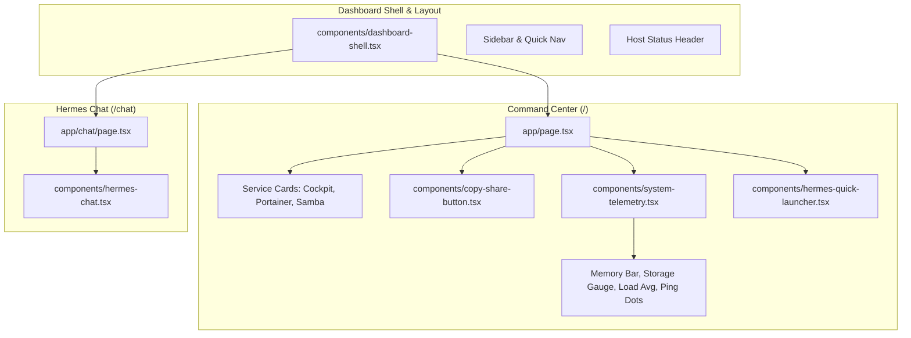

# Architecture Plan: Premium UI/UX Overhaul & Tactile Engineering

**TASK_ID:** `feat/premium-ui-ux-upgrade`  
**Architect:** `homelab-dashboard-architect`  
**Timestamp:** 2026-11-15T06:24:00+08:00

---

## 1. Architecture Summary

This architecture redesign elevates Harvy's Home Lab Dashboard from a cliché HUD template into a modern, tactile, obsidian-grade command center. It unifies design tokens under Tailwind CSS v4, implements Emil Kowalski micro-interaction physics, adheres to Vercel Web Interface Guidelines, and establishes clean boundaries between the home monitoring overview and the dedicated Hermes agent conversation experience.



### Discrete Atomic Tasks
- **TASK-001:** Standardize Obsidian & Slate Design Tokens in `app/globals.css`. Remove fake radar styles, harsh 52px cyan grids, and replace with subtle radial gradients, glassmorphic surface tokens, and spring easings.
- **TASK-002:** Refactor `components/dashboard-shell.tsx` into a sleek, modern navigation shell with clean typography, active pill indicator, and host connectivity badge.
- **TASK-003:** Redesign Service Bento Cards and Copy Pill in `app/page.tsx` and `components/copy-share-button.tsx` with tactile press states (`active:scale-[0.98]`), integrated live reachability pills, and refined button styling.
- **TASK-004:** Overhaul `components/system-telemetry.tsx` with visual progress gauges for RAM and Disk capacity, clean CPU load averages, and live animated ping dots.
- **TASK-005:** Create `components/hermes-quick-launcher.tsx` for the home page and refine `components/hermes-chat.tsx` for the dedicated `/chat` view, removing the duplicate full-viewport chat block from `app/page.tsx`.

---

## 2. Reused Components

| Existing Component / Helper | Reused For | Architectural Role |
| :--- | :--- | :--- |
| `components/ui/card.tsx` | Base container styling | Extended with glassmorphic border & hover radiance |
| `components/ui/badge.tsx` | Status tags and pills | Styled with subtle status glows (emerald, cyan, amber) |
| `components/ui/button.tsx` | Primary actions & copy | Equipped with tactile `:active` spring scaling |
| `lib/utils.ts` (`cn`) | Conditional styling | Class merging throughout all components |
| `lib/telemetry-types.ts` | Telemetry response typing | Preserved 100% for strict type safety |
| `lucide-react` | Semantic system icons | `Gauge`, `Boxes`, `HardDrive`, `Cpu`, `MemoryStick`, etc. |

---

## 3. Data Models & Types

Zero API schema modifications are required. All existing TypeScript contracts in [lib/telemetry-types.ts](file:///d:/homelab-dashboard/homelab-dashboard/lib/telemetry-types.ts) and [lib/dashboard-auth.ts](file:///d:/homelab-dashboard/homelab-dashboard/lib/dashboard-auth.ts) remain 100% untouched:

```ts
export interface TelemetryResponse {
  generatedAt: string;
  source: string;
  refreshIntervalSeconds: number;
  staleAfterSeconds: number;
  system: {
    loadAverage: Reading<LoadAverageValue>;
    memory: Reading<MemoryValue>;
    uptime: Reading<{ seconds: number }>;
    filesystems: {
      root: Reading<FilesystemValue>;
      storage: StorageReading;
    };
  };
  reachability: EndpointCheck[];
}
```

UI State extension for telemetry progress:
```ts
interface GaugeMetric {
  label: string;
  usedBytes: number;
  totalBytes: number;
  percentage: number;
  formattedUsed: string;
  formattedTotal: string;
}
```

---

## 4. Security & Auth

- **Zero Security Surface Alteration:** The hardened constant-time SHA-256 session comparison in `lib/dashboard-auth.ts` remains active.
- **Session Privacy:** The HTTP-only session cookie (`harvy_dashboard_owner`) and bearer session verification flow are preserved without change.
- **Strict Content Security:** All external links (`COCKPIT_URL`, `PORTAINER_URL`) retain `target="_blank" rel="noopener noreferrer"`.

---

## 5. QA Risk Matrix

| Risk ID | Potential Risk | Mitigation Architecture | Verification Method |
| :--- | :--- | :--- | :--- |
| **RISK-01** | Hydration mismatch with real-time clocks | Ensure `Date.now()` updates only within client `useEffect` hooks | Client-side console check during build & hydration |
| **RISK-02** | Stale telemetry polling overhead | Keep polling frequency at 15s with `AbortController` cleanup | Verify unmount cleanup and timer cancellation |
| **RISK-03** | Broken layout on mobile / tablet | Fluid CSS grid (`grid-cols-1 md:grid-cols-2 lg:grid-cols-3`) with responsive breakpoints | Responsive viewport checks (375px, 768px, 1280px) |
| **RISK-04** | Accidental regression of Windows Share copy | Fallback to `document.execCommand` when clipboard API unavailable | Unit/smoke test in insecure & secure context |
