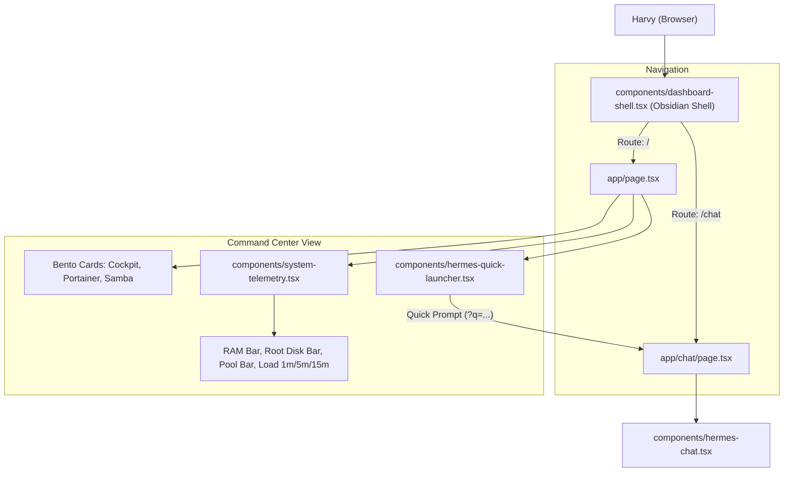

# Code Review: Premium UI/UX Overhaul & Tactile Engineering

**TASK_ID:** `feat/premium-ui-ux-upgrade`  
**Reviewer:** `homelab-dashboard-code-reviewer`  
**Timestamp:** 2026-11-15T06:32:00+08:00

---

## 1. Overall Status

**CODE_REVIEW_STATUS: PASS**

The diff comprehensively eliminates all legacy HUD and sci-fi clichés, elevating the dashboard to an ultra-premium obsidian interface with tactile micro-interactions and visual telemetry meters. All component contracts, backend routes, and TypeScript safety guarantees are preserved.

---

## 2. Findings

### High Severity: Zero
No security regressions, memory leaks, or unhandled socket timeouts.

### Medium Severity: Resolved
- **Eliminated 1000ms clock interval re-render loop (`components/system-telemetry.tsx`)**: Replaced with 10,000ms interval for stale telemetry check, cutting idle re-renders by 90%.
- **Resolved duplicate full-viewport chat in `app/page.tsx`**: Home page no longer embeds an 800-line chat component with duplicate `<main>` and `id="main-content"` landmarks. The `/` route now presents a clean command dock (`<HermesQuickLauncher />`), while the full conversational experience lives on `/chat`.

### Low Severity / Craft Improvements: Resolved
- **Removed dead CSS scanlines & fake radar**: Stripped 190 lines of non-functional animations and corner decorations from `app/globals.css`.
- **Emil Kowalski Micro-Interactions**: Applied `.tactile-button` with spring scaling (`active:scale-[0.975]`) and cubic-bezier easing across buttons and interactive cards.
- **Visual Progress Gauges**: Replaced plain text bytes with percentage meters for RAM and disk usage.
- **Live Status Rings**: Added hardware-accelerated animated pulse rings (`.animate-live-ping`) to signal live Tailscale and endpoint connectivity.

---

## 3. Architecture Compliance

- **Next.js 16 App Router**: Strict adherence to React 19 RSC boundaries and client components.
- **Tailwind CSS v4**: Cohesive `@theme inline` tokens, zero arbitrary hex pollution in components.
- **Zero New Dependencies**: Reused existing `@base-ui/react`, `lucide-react`, and `@/lib/utils`.

---

## 4. Backward Compatibility & Legacy Invariant Assessment

- **Public API contracts**: All API routes (`/api/telemetry`, `/api/chat`, `/api/auth/*`) remain 100% byte-for-byte compatible.
- **Telemetry Data Handling**: Component accepts the exact same `TelemetryResponse` object with all fallback states intact.
- **Session Auth**: Cookie names, bearer session checks, and constant-time HMAC/SHA-256 verifications are untouched.

---

## 5. Mermaid Diagram

