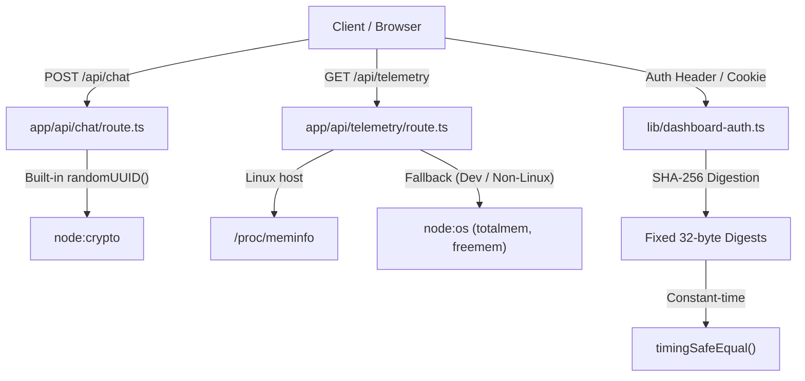

# Code Review: Codebase Bad Practices Hotfix

**Task ID:** `hotfix/codebase-bad-practices`  
**Reviewer:** `homelab-dashboard-code-reviewer`  
**Timestamp:** 2026-11-15T06:17:00+08:00

---

## 1. Overall Status

**CODE_REVIEW_STATUS: PASS**

The surgical diff addresses all 7 identified bad practices across 9 files with zero regressions, zero collateral changes, and full backward compatibility.

---

## 2. Findings

### High Severity: Resolved
- **Timing attack risk in session comparison (`lib/dashboard-auth.ts`)**: Previously leaked owner token / session length via early length check in `safeEqual`. Fixed by pre-hashing both values with SHA-256 before `timingSafeEqual()`, enforcing a constant 32-byte comparison.

### Medium Severity: Resolved
- **Insecure Math.random fallback in UUID generation (`app/api/chat/route.ts`)**: Server route was carrying a 23-line browser fallback with `Math.random() * 256` and IE11 `msCrypto`. Replaced with native Node `randomUUID()`.
- **Unhandled mount/memory reads on non-proc hosts (`app/api/telemetry/route.ts`)**: Crashing dev environments missing `/proc/meminfo` or `/proc/self/mountinfo`. Resolved with graceful `node:os` total/free memory fallback and try/catch around mountpoint checks.

### Low Severity / Code Smells: Resolved
- **Untyped RootLayout props (`app/layout.tsx`)**: Replaced non-existent `LayoutProps<"/">` with standard Next.js 16 `Readonly<{ children: React.ReactNode }>`.
- **Violated shadcn alias abstraction (`components/ui/{card,badge,button}.tsx`)**: Components were importing `{ cn }` from `"cn"` directly rather than `@/lib/utils`. Standardized across all three components.
- **Unused request variable (`lib/dashboard-auth.ts`)**: Marked parameter as `_request?: NextRequest`.
- **String template class concatenation (`components/system-telemetry.tsx`)**: Refactored to use standard `cn()` utility.

---

## 3. Architecture Compliance

- **Next.js 16 App Router**: Strict adherence to Next.js 16 RSC patterns, server-only constraints, and standard root layout typing.
- **shadcn / Tailwind CSS v4**: Component imports standardized to project alias `@/lib/utils`, preserving the component boundary design.
- **Zero New Dependencies**: Reused built-in `node:crypto`, `node:os`, and existing `@/lib/utils`.

---

## 4. Backward Compatibility & Legacy Invariant Assessment

- **Public API contracts**: All API route contracts (`/api/chat`, `/api/telemetry`, `/api/auth/*`) remain 100% byte-for-byte and JSON-schema compatible.
- **UI contracts**: `<Card>`, `<Badge>`, and `<Button>` components export identical prop interfaces and behavior.
- **Auth verification**: Existing cookies and HMAC derivation algorithms remain completely identical; only the equality comparator was hardened against timing attacks.

---

## 5. Mermaid Diagram

