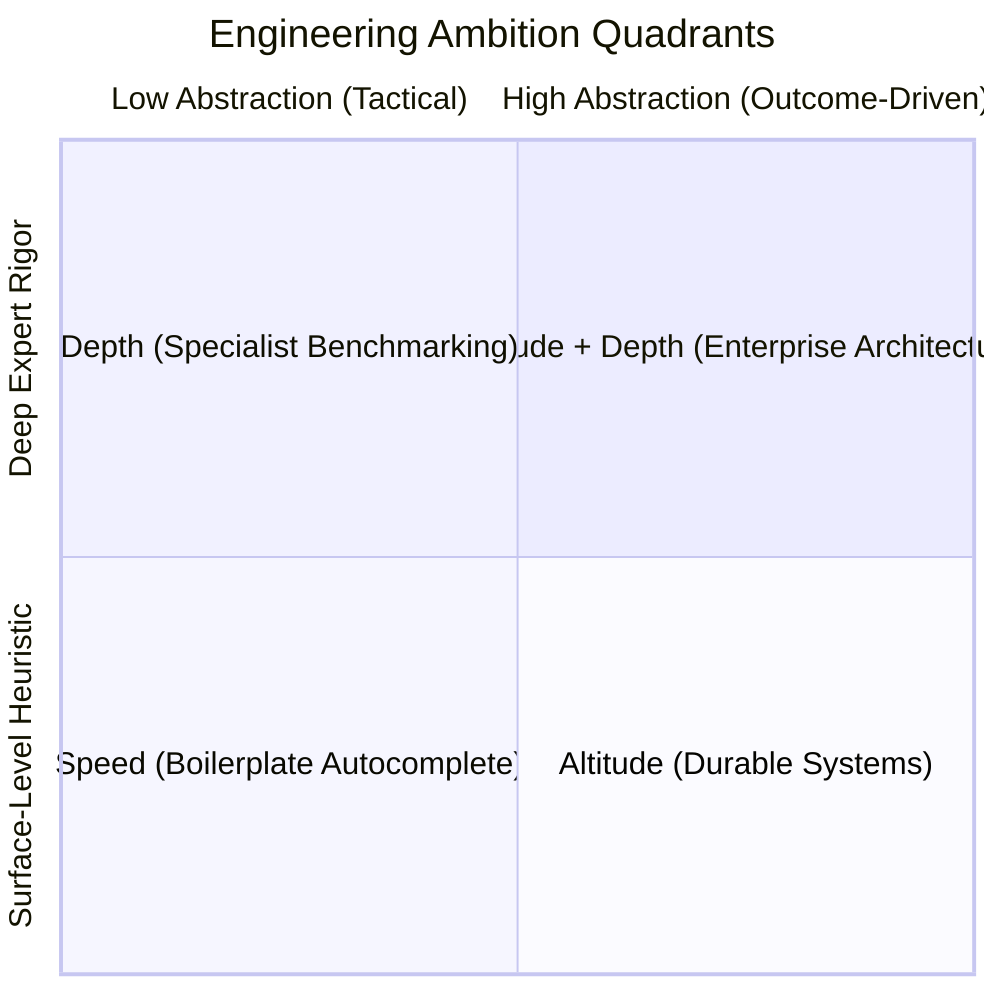
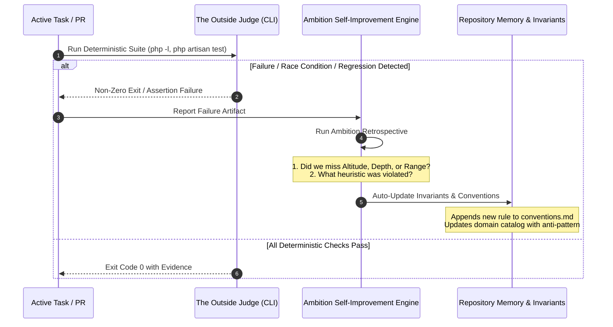

# Felix Rieseberg Ambition Framework & Self-Improvement Engine

A universal, cross-framework package for autonomous AI harnesses that drives engineering ambition beyond routine code completion (**Speed**) into **Altitude**, **Depth**, **Range**, and deterministic verification (**The Outside Judge**), powered by a closed **Self-Improvement Meta-Loop**.

---

## 1. The Core Ambition Matrix

Most AI harnesses plateau at **Speed** (writing routine code faster). This skill elevates execution across the other three dimensions and enforces objective outside reality:



| Dimension | Definition | Agent Transformation | Anti-Pattern to Eradicate |
| :--- | :--- | :--- | :--- |
| **Speed** | Doing the same task in less time. | Baseline commodity execution. | Measuring success purely by tokens/sec or line count. |
| **Altitude** | Raising the level of abstraction; solving the *outcome beyond the task*. | Moving from *"fix this bug"* to *"guarantee this invariant holds indefinitely and take humans out of the loop"*. | Churning through tickets without building durable regression safeguards. |
| **Depth** | Operating with the tools, raw data, and unreasonable benchmarks of the best professionals. | Insisting on raw profiling, execution plans, ACID transactions, exact math, and sub-5ms targets. | Hand-waving with markdown tables, naive regexes, or superficial summaries. |
| **Range** | Cross-disciplinary synthesis; replacing nouns with verbs; running adversarial crew lenses. | Transforming *"a new endpoint"* into active operations (*"atomically debiting balances without race conditions"*). | Pure feature bias without forensic, security, or financial auditing. |
| **The Outside Judge** | Non-LLM deterministic validation. | Verifying only via deterministic compilers, linters, test runners, and benchmarks. | Sychophantic LLM self-grading or trusting model assertions without terminal logs. |

---

## 2. Wiring Matrix (How to Inject into Any Agent Node)

This skill can be wired directly into any node of your multi-agent harness:

### A. Context Builder / Requirements Engineer (Node 0)
* **Rule: Verbs Over Nouns**: Replace static nouns (*"Order Controller"*) with active operational verbs (*"atomically validating inventory, debiting wallet balance, and recording immutable audit journals"*).
* **Altitude Anchor**:
  1. *What is the immediate task?*
  2. *What is the Goal Beyond the Goal?*
  3. *What durable invariant automation can we implement so humans never have to manually monitor this again?*

### B. Software Architect & System Designer (Node 1)
* **The 4-Part Depth Meta-Audit**:
  1. *Specialist Standard:* What would a Principal Systems Architect do here that wasn't asked for? (e.g. database row-locks, lateral joins, zero-copy buffers).
  2. *Rawest Material:* Inspect the lowest source of truth (raw database indices, transaction isolation levels, query execution plans).
  3. *Unreasonable Targets:* Benchmark targets that force superior engineering (e.g., sub-5ms execution, zero floating-point arithmetic, zero N+1 queries).
  4. *Outside Judge Definition:* The exact CLI commands (`vitest`, `tsc`, `cargo test`, `pytest`) that will objectively judge success.

### C. Implementation Engineer (Node 2)
* **Methodology Over Syntax**: Do not merely adopt the vocabulary of an expert; apply their *methods*.
* **Defensive Invariants**: Write code that self-checks mathematical conservation laws (e.g., balance sum before == balance sum after).

### D. Code Reviewer & Red-Team Auditor (Node 3)
* **Forensic Auditor & Concurrency Red Team Lens**:
  * Step into the shoes of a hostile short-seller or exploit hunter:
    * *How could two simultaneous duplicate requests exploit a race condition?*
    * *What happens on replay attacks or duplicate webhook deliveries?*
    * *Is there any floating-point or division precision leakage?*
    * *Are database locks held for minimal durations without long async I/O inside the transaction?*

### E. QA Validator & The Outside Judge (Node 4)
* **The Non-Negotiable Outside Judge Mandate**:
  * An agent or LLM is **strictly forbidden** from issuing a `PASS` based on reading code or mental review.
  * A `PASS` requires actual CLI execution outputs:
    ```bash
    # Deterministic Syntax & Lint Check
    php -l <target_php_file>
    # Deterministic Test Execution
    php artisan test <target_test>
    ```
  * Terminal exit code 0 and execution output must be pasted into the verification report.

---

## 3. The Autonomous Self-Improvement Loop (Meta-Evolution)

The ambition framework is not static—it actively learns from failures, bugs, and edge cases to prevent regressions across future tasks:



### Protocol for Self-Improvement (`evaluate-ambition`):

At the conclusion of each feature cycle or incident post-mortem:
1. **Analyze the Divergence**:
   * What did the model believe was correct that the Outside Judge proved was wrong?
   * Did the implementation pick a naive heuristic when an expert instrument was required?
2. **Extract the Invariant**:
   * Transform the defect into a strict, declarative rule.
   * *Example:* If an in-memory loop caused an N+1 query under load, synthesize:
     `❌ BANNED: in-memory map on parent collections. ✅ MUST USE: Lateral SQL join or database eager include.`
3. **Persist to Harness Memory**:
   * Automatically log the lesson into `.agents/memory/conventions.md` or `.agents/AMBITION_LOG.md`.
   * Future agent turns will load this rule during Phase 1 Context Boundary checks, permanently preventing recurrence.

---

## 4. Self-Efficacy Hacks (The Psychology of Ambition)

When prompts demand "reasonable" work, models output mediocre code. To break this psychological ceiling:
* **The Dantzig Framing**: Frame complex, unsolved architectural problems as straightforward, standard expectations.
* **The Bannister Benchmark**: Cite established high-performance benchmarks (e.g., *"LMAX Disruptor handles 6M orders/sec on single thread; our order queue must process 5,000 tx/sec with zero allocations"*).
* **Permission to Experiment**: Encourage creating scratch files in `.agent-work/<TASK_ID>/scratch/` to stress-test concurrency and prove invariants before committing changes.
