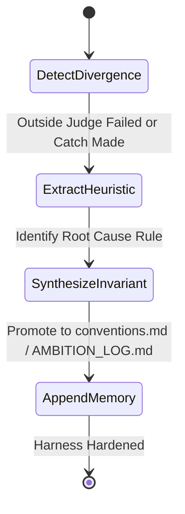

# The Ambition Self-Improvement Protocol

This protocol defines how an AI harness continuously learns, hardens its conventions, and avoids repeating past bugs or architectural missteps.

---

## 1. Trigger Conditions

The self-improvement loop triggers upon any of the following events:
1. **Outside Judge Rejection**: `tsc`, `vitest`, or linter fails on an implementation the agent thought was complete.
2. **Adversarial Catch**: Code reviewer or QA flags a race condition, precision leakage, or N+1 query.
3. **User Clarification / Escalation**: User corrects an architectural assumption or invariant.
4. **Task Completion / Release**: Post-task evaluation before archiving to `MEMORY_ARCHIVE.md`.

---

## 2. The 4-Step Evolutionary Loop



### Step 1: Detect the Divergence
Record the exact discrepancy between expectation and reality:
* *What did the agent believe?* (e.g., "Prisma 8 supports `.findMany()` or `{ where, data }`")
* *What did reality show?* (e.g., "Prisma 8 threw TypeError: `.findMany` is not a function")

### Step 2: Extract the Heuristic
Ask: *Why did the agent default to the wrong behavior?*
* Did it mimic outdated legacy code?
* Did it rely on generic training data rather than local project conventions?
* Did it pick the easiest route (Speed) instead of the robust route (Depth)?

### Step 3: Synthesize a Strict Invariant
Convert the insight into a compact, non-negotiable rule formatted as:
```markdown
❌ BANNED: <Specific anti-pattern or syntax> ➔ ✅ MUST USE: <Exact project pattern & example>
```

### Step 4: Promote to Project Memory
Append the new invariant directly into the repository's active memory subsystem:
* **Global Syntax / ORM rules** $\to$ `.agents/memory/conventions.md` and `.agents/rules/codebase-standards.md`
* **Domain-specific logic** $\to$ `.agents/memory/domains/<domain>.md`
* **Evolution Audit Log** $\to$ `.agents/AMBITION_LOG.md`

---

## 3. The Ambition Log Schema (`.agents/AMBITION_LOG.md`)

```markdown
# Ambition Framework Self-Improvement Log

## [TIMESTAMP] — TASK: <TASK_ID>
- **Dimension Evaluated:** [Altitude | Depth | Range | Outside Judge]
- **Divergence:** Model attempted in-memory filter on large dataset.
- **Outside Judge Catch:** Vitest load test exceeded 250ms threshold.
- **Promoted Invariant:** "❌ BANNED: in-memory filter on collections over 100 rows. ✅ MUST USE: Prisma 8 database where() clause."
- **File Updated:** `.agents/memory/conventions.md`
```
