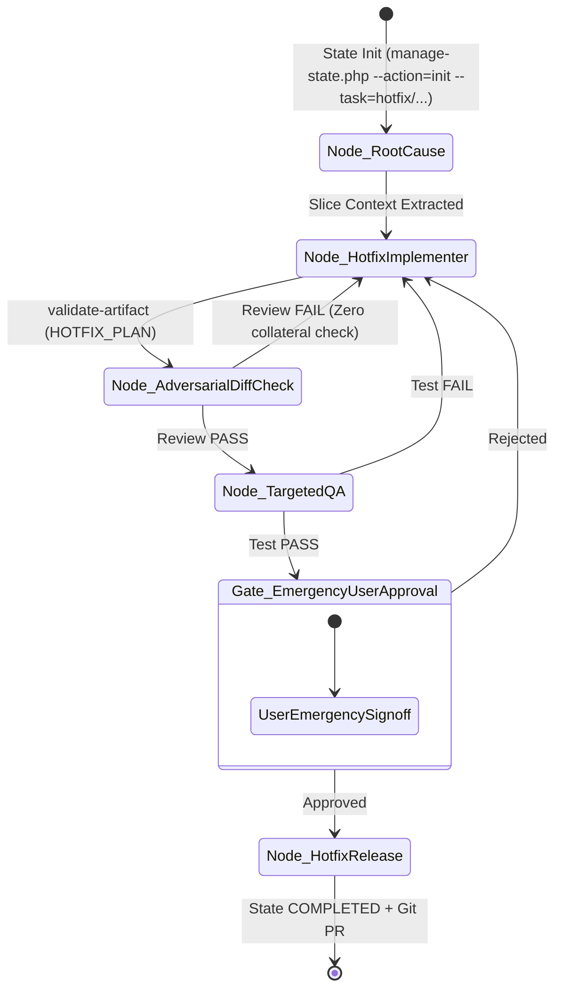

# Fast-Track Hotfix State Graph Workflow

A streamlined, token-efficient hotfix state machine designed for rapid, surgical remediation of production bugs, regressions, or security issues in **RealEstate Backend**.

---

## 1. Hotfix State Graph Flow



---

## 2. State Machine Execution Steps

### Step 1: State Init & Root-Cause Analysis
1. **Initialize State**:
   ```bash
   php .agents/scripts/manage-state.php --action=init --task=hotfix/<slug> --complexity=SMALL
   ```
2. **Context Policy & Skills**: Read error stack trace / bug description + exact defective file. Apply `systematic-debugging` (formulate testable hypothesis before altering code).
3. **Action**: Pinpoint root cause using line slice reads (`view_file` with line range).
4. **Output**: `.agent-work/hotfix-<slug>/HOTFIX_CONTEXT.md`.
5. **Transition**:
   ```bash
   php .agents/scripts/manage-state.php --action=transition --task=hotfix/<slug> --to=node_hotfix_implementer
   ```

---

### Step 2: Hotfix Implementation (Surgical Patch)
1. **Context Policy & Skills**: Read `STATE.json`, `HOTFIX_CONTEXT.md`, and exact defective file. Apply `laravel-tdd` (reproduce bug with a failing test first).
2. **Action**:
   - Draft `.agent-work/hotfix-<slug>/HOTFIX_PLAN.md` (exact lines to touch).
   - Apply smallest surgical fix possible (no unrequested refactoring).
   - Review `git diff`.
3. **Output**: `HOTFIX_REPORT.md`.
4. **Transition**:
   ```bash
   php .agents/scripts/manage-state.php --action=transition --task=hotfix/<slug> --to=node_adversarial_diff_check
   ```

---

### Step 3: Adversarial Diff Review
1. **Context Policy & Skills**: Read `git diff` + `.agents/memory/conventions.md`. Apply `laravel-security` (verify patch does not introduce tenant or auth bypass).
2. **Action**: Verify patch does not cause regressions, introduce concurrency risks, or break security invariants.
3. **Output**: `CODE_REVIEW.md` (`CODE_REVIEW_STATUS: PASS | FAIL`).
4. **Conditional Edge**:
   ```bash
   php .agents/scripts/manage-state.php --action=set-verdict --task=hotfix/<slug> --target=review --verdict=<PASS|FAIL>
   ```

---

### Step 4: Targeted QA Verification
1. **Context Policy & Skills**: Read `git diff` + affected test file. Apply `pest-testing`, `verification-before-completion` (paste non-empty CLI test output and exit code).
2. **Action**: Run targeted test command: `php artisan test <file>` (or `./vendor/bin/pest <file>`).
3. **Output**: `QA_REPORT.md` (with short Manual Verification Checklist).
4. **Conditional Edge**:
   ```bash
   php .agents/scripts/manage-state.php --action=set-verdict --task=hotfix/<slug> --target=qa --verdict=<PASS|FAIL>
   ```

---

### Step 5: User Emergency Gate
1. **Action**: Present minimal diff and verification steps to user.
2. **PAUSE AND WAIT** for user confirmation (`approved`, `complete`, `ship it`).
3. **Transition**:
   ```bash
   php .agents/scripts/manage-state.php --action=transition --task=hotfix/<slug> --to=node_hotfix_release
   ```

---

### Step 6: Hotfix Release
1. **Action**:
   - Append entry to `MEMORY_ARCHIVE.md` and pointer row to `MEMORY.md`.
   - Create hotfix commit: `fix(<scope>): <concise description>`.
   - Create pull request to target base branch (`master`).
2. **State Complete**:
   ```bash
   php .agents/scripts/manage-state.php --action=transition --task=hotfix/<slug> --to=completed --status=COMPLETED
   ```
