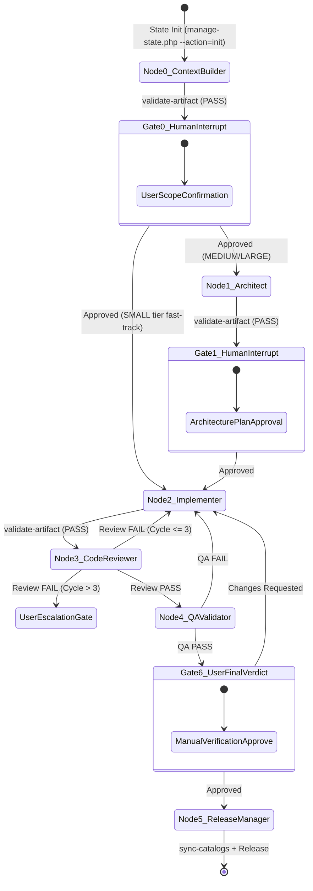

# In-House Micro-LangGraph Multi-Agent Feature Workflow

A token-efficient, zero-dependency multi-agent state graph that enforces persistent state tracking (`STATE.json`), deterministic CLI validation gates, dynamic complexity routing, cyclic remediation loops, and human interrupt checkpoints for **RealEstate Backend**.

---

## 1. State Graph Topology & Node Architecture



---

## 2. Task Complexity Routing Matrix

| Tier | Criteria & Examples | State Graph Path | Context Budget |
| :--- | :--- | :--- | :--- |
| **SMALL** | Typos, 1-line null guards, config tweaks | **Node 0 ➔ Gate 0 ➔ Node 2 ➔ Node 4 ➔ Gate 6 ➔ Node 5** (Skips Architect/Review) | Ultra-lean (`git diff` only) |
| **MEDIUM** | Single endpoint, query scope, service method | **Node 0 ➔ Gate 0 ➔ Node 1 ➔ Gate 1 ➔ Node 2 ➔ Node 3 ➔ Gate 6 ➔ Node 5** | Plan + Diff + Review |
| **LARGE** | Core domain engine, payments, auth, migrations | **Full 7-Step Graph with all Nodes, Gates & QA Verification** | Full Waterfall |

---

## 3. The Shared State Channel (`.agent-work/<TASK_ID>/STATE.json`)

All agents read and update the machine-readable task state file:

```json
{
  "task_id": "feat/example-feature",
  "workflow_type": "FEATURE",
  "complexity": "MEDIUM",
  "current_node": "node_2_implementation",
  "status": "RUNNING",
  "review_cycles": 0,
  "qa_cycles": 0,
  "artifacts": {
    "task_context": ".agent-work/feat/example-feature/TASK_CONTEXT.md",
    "architecture_plan": ".agent-work/feat/example-feature/ARCHITECTURE_PLAN.md",
    "implementation_plan": ".agent-work/feat/example-feature/IMPLEMENTATION_PLAN.md"
  },
  "gate_checkpoints": {
    "gate_0_scope": "APPROVED",
    "gate_1_architecture": "APPROVED",
    "gate_6_final_verdict": "PENDING"
  }
}
```

---

## 4. State Machine Execution Steps

### Step 1: Node 0 — Task Context Builder & Classifier
1. **Initialize State**:
   ```bash
   php .agents/scripts/manage-state.php --action=init --task=<TASK_ID> --complexity=<SMALL|MEDIUM|LARGE>
   ```
2. **Context Policy & Skills**: Read prompt + `.agents/memory/INDEX.md` + `conventions.md`. Apply `subagent-driven-development` (task packet sizing & boundaries), `codebase-inventory`, `laravel-specialist`, `laravel-patterns`.
3. **Action**: Interactively interview user, determine complexity, output `.agent-work/<TASK_ID>/TASK_CONTEXT.md`.
4. **Deterministic Gate**:
   ```bash
   php .agents/scripts/validate-artifact.php --file=.agent-work/<TASK_ID>/TASK_CONTEXT.md --type=task_context
   ```
5. **Human Interrupt Checkpoint (Gate 0)**: Present scope. **PAUSE AND WAIT** for user confirmation.
   - Upon approval: `php .agents/scripts/manage-state.php --action=transition --task=<TASK_ID> --to=node_1_architect` (or `node_2_implementation` if SMALL).

---

### Step 2: Node 1 — Software Architect (MEDIUM / LARGE Tier)
1. **Context Policy & Skills**: Read `TASK_CONTEXT.md` + target domain chunk under `.agents/memory/domains/` + `conventions.md` + `catalogs/services.md`. Apply `multi-tenant-architecture`, `excalidraw-diagram-generator`, `database-migrations`, `postgresql-optimization`, `spatie-laravel-php`, `architecture-designer`, `laravel-specialist`, `laravel-patterns`, `laravel-declarative-caching`.
2. **Action**: Audit reuse opportunities, verify tenant boundaries (leading `tenant_id` composite index design), synchronize Excalidraw blueprints if models/flows are modified, evaluate QA risks, generate `ARCHITECTURE_PLAN.md` and `IMPLEMENTATION_TASKS.md`.
3. **Deterministic Gate**:
   ```bash
   php .agents/scripts/validate-artifact.php --file=.agent-work/<TASK_ID>/ARCHITECTURE_PLAN.md --type=architecture
   ```
4. **Human Interrupt Checkpoint (Gate 1)**: Present architecture plan. **PAUSE AND WAIT** for user approval.
   - Upon approval: `php .agents/scripts/manage-state.php --action=transition --task=<TASK_ID> --to=node_2_implementation`

---

### Step 3: Node 2 — Implementation Engineer
1. **Context Policy & Skills**: Read `STATE.json`, `ARCHITECTURE_PLAN.md`, `IMPLEMENTATION_TASKS.md`, `ACCEPTANCE_CRITERIA.md`. Apply `laravel-tdd`, `pest-testing`, `spatie-laravel-php`, `systematic-debugging`, `database-migrations`, `laravel-specialist`, `laravel-patterns`, `laravel-declarative-caching` (Eloquent eager loading, tenant scoping, zero in-memory N+1 loops).
2. **Action**:
   - **Rule 0**: Draft `IMPLEMENTATION_PLAN.md` before editing any code.
   - **Deterministic Gate**: `php .agents/scripts/validate-artifact.php --file=.agent-work/<TASK_ID>/IMPLEMENTATION_PLAN.md --type=implementation_plan`.
   - **TDD Requirement**: Write Pest feature test in `tests/Feature/Tenanted` first (red), then implement production code (green), refactor.
   - Implement minimal surgical changes following SOLID principles.
   - Self-review via `git diff`.
3. **State Transition**:
   ```bash
   php .agents/scripts/manage-state.php --action=transition --task=<TASK_ID> --to=node_3_code_reviewer
   ```

---

### Step 4: Node 3 — Code Reviewer (Diff-Centric)
1. **Context Policy & Skills**: Read `git diff` + `ACCEPTANCE_CRITERIA.md` + `conventions.md`. Apply `laravel-security`, `verification-before-completion`, `multi-tenant-architecture`, `laravel-specialist`, `laravel-patterns`, `qa-engineer`.
2. **Action**: Adversarial review using severity vectors (`🔴 bug:`, `🟡 risk:`, `🔵 nit:`, `❓ q:`). Verify tenant isolation, unscoped validation rules, mass-assignment, and leading `tenant_id` indexing. Generate Mermaid sequence flow.
3. **Output**: `CODE_REVIEW.md` (`CODE_REVIEW_STATUS: PASS | FAIL`).
4. **Deterministic Gate**:
   ```bash
   php .agents/scripts/validate-artifact.php --file=.agent-work/<TASK_ID>/CODE_REVIEW.md --type=code_review
   ```
5. **Conditional Edge Decision**:
   ```bash
   php .agents/scripts/manage-state.php --action=set-verdict --task=<TASK_ID> --target=review --verdict=<PASS|FAIL>
   ```
   - **If FAIL (cycle ≤ 3)**: Automatically loops back to Node 2 (Implementer).
   - **If FAIL (cycle > 3)**: Halts at **User Escalation Gate** (Circuit Breaker).
   - **If PASS**: Advances to Node 4 (QA Validator).

---

### Step 5: Node 4 — QA Validator
1. **Context Policy & Skills**: Read `ACCEPTANCE_CRITERIA.md`, `QA_CRITERIA.md`, `CODE_REVIEW.md` (findings only), `git diff`. Apply `pest-testing`, `verification-before-completion`, `systematic-debugging`, `qa-engineer`, `laravel-specialist`. Enforce [`test-rules.md`](file:///{{WORKSPACE_ROOT}}/.agents/rules/test-rules.md).
2. **Action**: Validate requirements using FIRST assertion matrix, execute deterministic CLI Pest suite (`php artisan test`), paste exact execution evidence and exit code (evidence before assertions), produce step-by-step Manual Verification Guide.
3. **Output**: `QA_REPORT.md` (`QA_STATUS: PASS | FAIL`).
4. **Deterministic Gate**:
   ```bash
   php .agents/scripts/validate-artifact.php --file=.agent-work/<TASK_ID>/QA_REPORT.md --type=qa
   ```
5. **Conditional Edge Decision**:
   ```bash
   php .agents/scripts/manage-state.php --action=set-verdict --task=<TASK_ID> --target=qa --verdict=<PASS|FAIL>
   ```
   - **If FAIL**: Loops back to Node 2 (Implementer).
   - **If PASS**: Transitions to Gate 6 (`WAITING_USER_APPROVAL`).

---

### Step 6: Gate 6 — User Final Verdict Checkpoint
1. **Action**: **STOP AUTOMATION.** Present implementation summary, logic walkthrough, Mermaid diagram, and manual verification guide to user.
2. **Human Decision**:
   - **If user reports issues**: `php .agents/scripts/manage-state.php --action=transition --task=<TASK_ID> --to=node_2_implementation --status=REMEDIATING`
   - **If approved** (`complete`, `approved`, `ship it`): `php .agents/scripts/manage-state.php --action=transition --task=<TASK_ID> --to=node_5_release_manager`

---

### Step 7: Node 5 — Release Manager
1. **Condition**: Verified `STATE.json` has `gate_6_final_verdict: APPROVED`. Apply `verification-before-completion`, `documentation-agent`, `codebase-inventory`.
1. **Condition**: Verified `STATE.json` has `gate_6_final_verdict: APPROVED`. Apply `documentation-agent`, `codebase-inventory`.
2. **Action**:
   - Append entry to `MEMORY_ARCHIVE.md` and pointer row to `MEMORY.md`.
   - Run deterministic catalog sync: `php .agents/scripts/sync-catalogs.php`.
   - Conventional commit, push, PR, write `RELEASE_REPORT.md`.
3. **State Complete**:
   ```bash
   php .agents/scripts/manage-state.php --action=transition --task=<TASK_ID> --to=completed --status=COMPLETED
   ```

